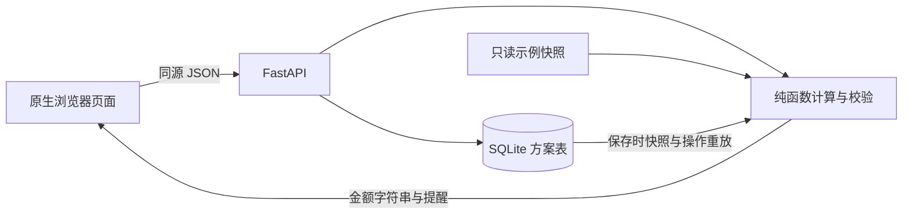

# 设计与交付说明

任务：VC-FIN-001 / V3.0。基准组合：DEMO-001，固定快照 SNAP-20261102。我使用 Codex 辅助完成需求拆解、设计、实现和验证，以下说明设计取舍、实际验证结果及后续改进方向。

## 1. 需求理解与交互

目标是帮助使用者看到当前集中度，并在交易前验证一组调整。这里的「提醒」只针对标的 >30% 或行业 >50%，不表示收益预测、综合风险评分或投资建议。

| 需求 | 页面与完成条件 |
|---|---|
| FR-01 概览 | 总资产、现金、持仓数量/价格/市值/占比、行业分布和北京时间快照；用 AC-01 核对 |
| FR-02 集中度 | 同时列出触发对象、实际比例、阈值；用 AC-02 检查等于阈值不提醒 |
| FR-03 模拟 | 原始组合出发，逐笔追加买卖；展示操作后余额、原始/模拟持仓与行业占比；AC-03/04 |
| FR-04 保存 | 命名保存，列表及只读详情，独立 URL；刷新与真实服务重启后恢复；AC-05 |
| FR-05 后端 | 金额计算、数量/现金/持仓校验与持久化全部在 Python；前端仅格式化、画图和前置提示 |

流程：概览 → 模拟 → 成功追加操作 → 对比 → 命名保存 → 只读详情 → 从列表重新打开。浏览器只在接口成功时替换有效操作序列；失败保留表单输入和原有结果。请求期间禁用提交，显示校验状态。加载有文字提示；空操作有引导、保存按钮不可用；空方案列表有创建入口；读失败有重试/返回；保存失败保留模拟。清空当前操作需要确认。切换页面保留内存中的模拟，刷新不保存草稿；详情 URL 和数据库支持已保存方案恢复。

## 2. 结构、数据与状态



- **原始快照**：组合 ID、名称、币种、快照 ID/时间、初始现金、标的目录、每个标的的价格/行业/原始数量、规则。启动读入，验证基本结构，不提供写接口。
- **操作**：`{symbol, side: buy|sell, quantity}`；数组顺序就是执行顺序。最多 100 笔，每笔 1～1,000,000,000 股，仅给定标的。
- **模拟**：每次复制原始数量和现金，重放完整序列；返回 `before`、`after`、逐笔 `steps`、`engine_version`。失败中止并丢弃局部状态，不落库。
- **方案**：SQLite `plans(id, request_id UNIQUE, name, created_at, snapshot_json, operations_json, engine_version)`。名称 1～60 字，去首尾空白，可同名；ID 是 UUID；时间以 UTC 存储、界面用北京时间。
- **保存与重开**：先重新校验完整操作，再用事务原子保存快照和操作，不保存派生金额。重开用保存时快照重算，当前原始数据修改也不影响历史结果。计算版本不兼容则明确返回 409，不静默用新规则重放。当前只有 v1，尚无迁移器。

SQLite 每次操作独立连接且显式关闭；写入使用 `BEGIN IMMEDIATE` 和 5 秒锁等待。`request_id` 实现保存重试幂等：同请求同内容返回同一方案，内容不同则冲突。前端为同一保存内容重用请求 ID，网络超时后重试不会生成重复记录。

## 3. 接口契约

| 方法与路径 | 输入 | 成功输出 / 主要错误 |
|---|---|---|
| GET `/api/portfolio` | 无 | 原始估值、明细、行业、提醒、规则 |
| POST `/api/simulations` | `snapshot_id, operations[]` | 200：前后结果及步骤；422：非法操作；409：快照不匹配 |
| POST `/api/plans` | 上述字段 + `name, request_id(UUID)` | 201：已创建详情；200：幂等重试；422：空名称/空方案/无效交易；409：保存冲突 |
| GET `/api/plans` | 无 | `{plans:[id,name,created_at,snapshot_id,operation_count]}`，按创建时间倒序 |
| GET `/api/plans/{id}` | 方案 ID | 详情和重放结果；404：不存在；409：引擎版本不兼容 |
| GET `/api/health` | 无 | 服务状态和计算版本 |

示例模拟请求：

```json
{"snapshot_id":"SNAP-20261102","operations":[
  {"symbol":"A01","side":"sell","quantity":100},
  {"symbol":"A02","side":"buy","quantity":100}
]}
```

错误统一为 `{"error":{"code":"INSUFFICIENT_CASH","message":"第 1 笔：现金不足…","field":"quantity","operation_index":1}}`。操作序号从 1 开始，非逐笔错误为 null。数量严格验证，JSON 布尔、小数（包括 1.0）、字符串均不当作整数。操作通过明确的请求模型在 OpenAPI 中描述；拒绝未知字段和客户端伪造的计算结果，不信任浏览器前置校验。SQL 错误返回 503，未知异常返回统一 500 JSON 和重试提示，内部详情只写服务日志。

## 4. 计算口径与异常

金额入口以 Decimal 解析，再精确转换为整数分；价格和现金只接受至多两位小数。市值 = 整数分价格 × 数量；总资产 = 持仓市值 + 现金。买入扣现金、加数量；卖出反向，使用前序余额/持仓。每次模拟在返回前检查总资产守恒。

占比展示用 Decimal 除法、ROUND_HALF_UP，返回两位小数字符串；前端仅加千分位。判定不使用展示比例，而使用整数交叉乘法：若阈值为 n/d，比较 `市值 × d > 总资产 × n`，严格大于才触发。现金只进分母，行业分子不含现金。全部卖出时行业为 0%，总资产为 0 的防御分支定义占比为 0%，避免除零。

验证特意把 A01 价格改为 100.01，再卖 100 股：实际占比略大于 30%、科技略大于 50%，两者显示仍可能为 30.00% / 50.00%，提醒必须保留。该例防止“先舍入再判定”的常见 AI 实现错误。

价格缺失/非正值目前启动失败，不能按零估值；行业为空亦失败。若扩展脏数据导入，应拒绝无价格标的参与交易，行业未知则单列「未知」且提示信息不足，不擅自归类。此原型不实现导入/修复流程。

## 5. 关键取舍

| 决策 | 采用理由 | 备选及代价 |
|---|---|---|
| FastAPI + 原生页面，同源服务 | 后端输入契约清楚；只有三类页面，免前端构建与跨域配置，评审一步启动 | React/Vue 更适合复杂状态和多人维护，但本次会增加构建依赖；状态增长时应迁移 |
| SQLite 而非浏览器存储/JSON 文件 | 重启恢复、事务和幂等约束直接满足要求；不用部署数据库 | localStorage 不满足服务端持久化；JSON 要额外处理并发覆盖和中断写入 |
| 保存完整快照和操作，不存结果 | 历史隔离且没有两份派生结果漂移；六标的、最多百笔的重放成本低 | 只存快照 ID 依赖外部不可变快照库；存结果可免重算，但须定义校验和迁移策略 |
| 无服务器临时模拟会话 | 纯函数容易测试，失败原子性自然成立，页签互不覆盖 | 服务端草稿便于跨设备恢复，但需要会话和过期策略，本任务不需要 |

## 6. 已完成、限制与复盘

FR-01～FR-05 均完成。复审后的 35 个计算/API 测试方法通过；浏览器核心验收 13 项、专项交互检查 17 项通过，包括真正更换服务进程后的恢复；桌面与 390px 手机截图已检查。具体证据见 VERIFY.md 和 REVIEW.md。

未扩展项：草稿自动恢复、单笔操作编辑/撤销、已保存方案编辑删除、账户/权限、行情接入、真实交易、自动备份、数据库 schema 迁移、列表分页。它们不属于附件必做范围。当前列表一次读全，适合本地小规模数据；未做大数据/并发压测、辅助技术专项审计或 macOS/Linux 实机测试。前端已拆为请求、格式化、通用视图、编辑表单、路由状态 5 个模块，部分视图仍采用长模板；表格在小屏内横向滚动。

与初始方案差异：实现阶段未建立 Git 仓库，采用实现前留存文件与 SHA-256 记录核对 PLAN 原稿未改；Git 在我准备将项目公开提交时才初始化。实现中增加了保存幂等、快照版本拒绝和异常恢复验证。Playwright CLI 下载在原受限环境 DNS 失败，改用已安装的 Python Playwright 与 Edge；本地事件循环在受限环境阻塞，调整执行环境后继续测试。这些环境问题与业务计算失败分别记录。

实际投入：从 2026-11-09 14:46（北京时间）开始，结束时间与实际墙钟用时见 [DELIVERY.md](DELIVERY.md)。该记录覆盖 AI 辅助开发与验证过程，包含工具运行等待；我个人的阅读和讲解准备时间未单独统计。

本轮复审已完成原先提出的前端模块拆分及请求竞态、键盘焦点检查。如果再增加一小时：优先完善超时重试和原生离开弹窗矩阵，其次做方案分页或拆分长模板。不会优先增加行情或投资推荐，因为这不能补强本次核心验收。

## 附录：AI 协作与实际核验

我使用 Codex 桌面应用协助开发，通过 Python、FastAPI TestClient/unittest 和 Playwright Python + Edge 进行验证。原型未接入模型服务或外部金融 API，本次也未使用子代理。以下记录我向 AI 提供的任务背景、关键要求，以及验证和修正的依据；其中自动化检查由 AI 调用工具执行。

1. **需求拆解**。我向 AI 提供任务说明、4 页 PDF 和示例 JSON，以 AC-01～AC-05 及三类提交材料为完成标准。在开始实现前，我要求 AI 先核验原始附件。AI 调用工具检查 ZIP 完整性、逐字节比较提取文件、核对哈希，并使用 Decimal 独立计算基准数值、逐页查看 PDF；确认总资产 100,000 元、现金 20,000 元、A01 占比 40%、科技行业占比 60%，同时核对依赖锁文件等交付要求。开工方案在应用源码编写前留存，金额整数分、服务端重放和快照保存的选择据此展开。
2. **实现与计算核验**。AI 生成纯计算模块和接口；验证不复制代码自身结果，而把任务书的常量写成断言，追加舍入阈值、卖出所得用于后续买入、失败状态不变、随机序列资产守恒。发现测试修改数据库后没关闭连接，Windows 清理报 WinError 32；显式关闭后重跑。生产存储连接也使用 finally 关闭。接口同时验证拒绝伪造结果、改动当前种子后历史方案不变。
3. **界面及持久化核验**。AI 生成页面后，用真实浏览器逐步输入并断言显示数值；保存、刷新、停止服务、启动新 PID，再逐字段比较保存前后 JSON。截图目视检查发现名称输入框漏写 type，导致默认样式；补齐后重拍。代码检查也修正了成功请求后按钮仍显示“正在校验”的状态，以及图表中心硬编码总资产。采用依据是可复现的断言、实际截图和服务记录，不以“AI 说通过”替代证据。

完成初版后，我进一步要求 AI 从需求理解、功能完整性、工程质量、产品体验和 AI 协作五个方向复审。AI 在旧提交包上复现并修复了 7 个交互问题，补全明确的接口模型和异常兜底。专项检查修复前后记录、测试脚本自身的纠错过程和剩余边界见 [REVIEW.md](REVIEW.md)。最初的 PLAN 原稿保持不变；首次 31 项测试通过只作为阶段性结果，不代表已经覆盖所有交互。
