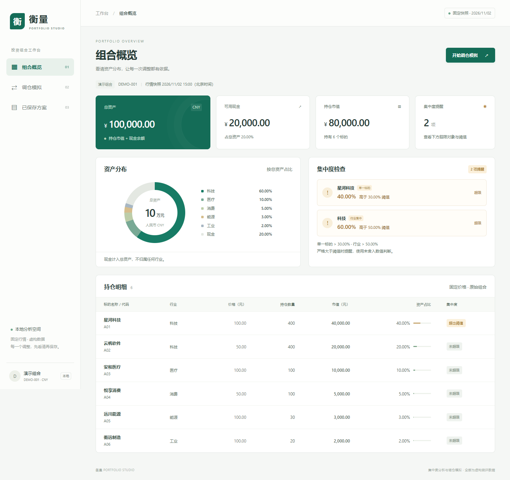
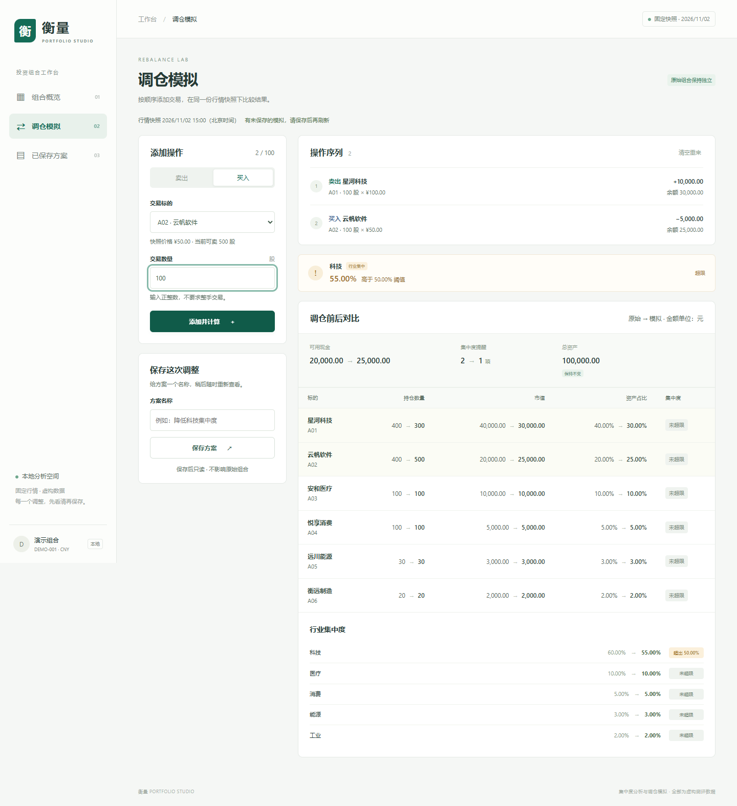
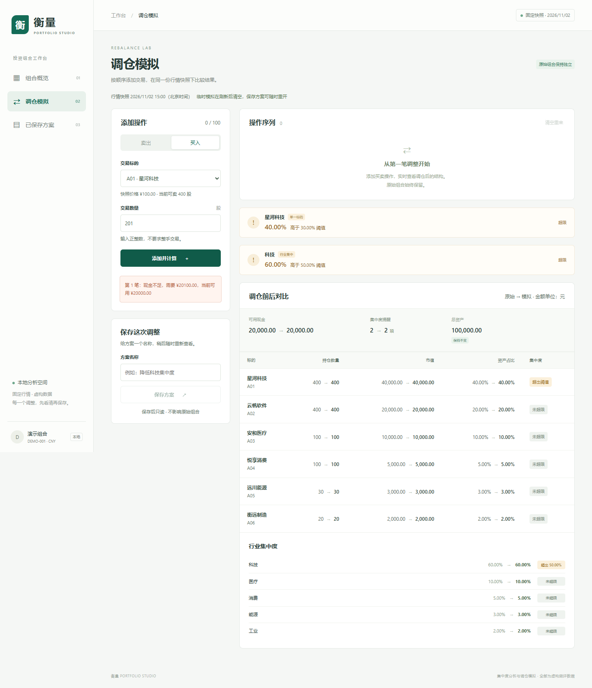
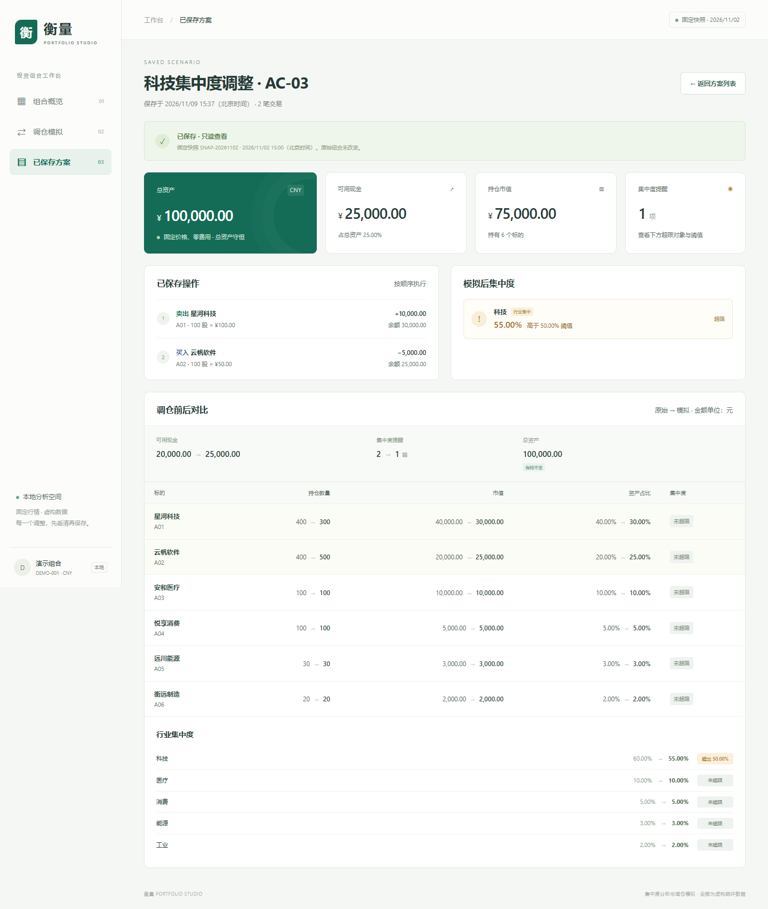

# 验证记录

执行日期：2026-11-09，北京时间。运行环境：Windows，Python 3.11，FastAPI 0.109.0；浏览器为 Edge 156.0.4314.58，Playwright Python 1.62.0。测试均由本次实际工具执行，不是计划清单。源码哈希和执行时间见 [浏览器原始结果](output/verification/browser-results.json)。

## 基准验收

| 用例 | 实际操作 | 预期 | 实际结果与结论 |
|---|---|---|---|
| AC-01 | GET 原始组合，并打开概览 | 总资产 100,000；现金 20,000；A01 40%；科技 60%；两提醒 | 全部相符，**通过** |
| AC-02 | 卖出 A01 100 | 现金 30,000；A01 数量 300、市值 30,000、占比 30%；科技 50%；无提醒 | 全部相符，总资产仍 100,000，**通过** |
| AC-03 | 在上一步之后买入 A02 100 | 现金 25,000；A02 数量 500、市值 25,000；科技 55%；一项行业提醒 | 全部相符，总资产仍 100,000，**通过** |
| AC-04 | 原始组合买 A01 201 / 卖 A01 401；输入 0、-1、1.5 | 拒绝并明确提示，有效结果不变 | 前两种返回 422 及现金/持仓错误；非法数量由前端和后端分别检查；原结果不变，**通过** |
| AC-05 | 保存 AC-03，刷新，实际停止并重新启动服务，再打开详情和列表 | 保存结果不变，原始组合仍现金 20,000、A01/A02 各 400 | 旧/新服务 PID 不同，完整方案 JSON 相等；原组合断言一致，**通过** |

## 已执行的追加检查

`python -m unittest discover -v`：最新复审版本 **35 个测试方法通过**，见 [review-tests.txt](output/verification/review-tests.txt)；首次版本 31 个方法的输出保留在 [tests.txt](output/verification/tests.txt)。参数化子用例包含多种数量类型及无效操作，另有固定种子的 20 组随机有效交易序列。

另外从零创建 `.venv`，按 `requirements-dev.txt`（包含运行锁文件）安装了固定版本依赖；`pip check` 返回 `No broken requirements found`，同一套 31 个测试全部通过。见 [全新环境测试输出](output/verification/clean-environment-tests.txt) 和 [实际安装版本](output/verification/installed-dependencies.txt)。安装过程中代理连接曾自动重试，最终安装成功；运行时不需要外网。

| 检查 | 实际结果 |
|---|---|
| 展示舍入不能掩盖超限 | A01 价格 100.01 后卖 100；标的/行业显示 30.00% / 50.00%，实际略超限，提醒保留 |
| 顺序敏感 | 卖 A01 100 再买 A03 300 成功且现金 0；反序现金不足 |
| 使用当前持仓 | 先买 A01 1，再卖 401 成功；不能只看原始可卖量 |
| 失败原子性 | 第三笔超额买入失败，前两笔对比区域与操作数完全不变 |
| 全现金和零资产防御 | 全部卖出后现金 100,000、零持仓、无提醒；零资产测试无除零 |
| 类型与范围 | 0、负数、小数、1.0、布尔、字符串、空值、过大数量、未知标的/方向被拒绝 |
| 保存幂等 | 相同 request_id 和内容返回同 ID；相同 key 改内容返回 409；同名但不同请求可保存 |
| 无效方案不入库 | 空方案/空名/无效交易拒绝；列表记录数不增加 |
| 绑定历史快照 | 修改当前种子价格、快照 ID 后建立新应用，已保存详情完全不变 |
| 版本与接口错误 | 失效快照、引擎不兼容 409；缺失方案 404；坏 JSON、伪造结果 422；存储异常 503 |
| 文件访问边界 | 根目录静态页可访问；数据库、附件及路径跳转访问返回 404 |
| 浏览器恢复状态 | 空方案列表有引导；断网显示错误，恢复网络后重试成功；不存在方案可返回 |
| 移动端 | 390×844 视窗无整页横向溢出；宽表格在容器内滚动 |
| 浏览器运行 | 全流程无未捕获 JavaScript 异常；后端有预期的 422/404 记录 |
| JavaScript 语法 | `node --check frontend/app.js` 通过 |
| 输入材料 | ZIP 校验通过；PDF/JSON 提取前后哈希一致；PLAN.md 开工哈希保持一致 |

浏览器脚本共 **13 个检查点**，与上表并非简单相加的独立测试数量。保存详情来自自动化脚本的隔离数据库，不会预先写入评审者的默认库。

五维复审另执行 **17 项专项交互检查**，覆盖未保存提醒、保存加载、延迟响应、错误恢复、快照规则显示、键盘焦点及方案名转义；[最新专项结果](output/verification/review-browser-results.json)全部通过。[修复前探测](output/verification/review-before.json)保留旧提交包的 7 个失败检查点；问题分析和修正见 [REVIEW.md](REVIEW.md)。本轮在已按锁文件安装的 `.venv` 中运行 35 项回归，无新增运行依赖。

## 截图与视觉检查

以下是实际运行截图，未经拼接或重绘。桌面视窗 1440×1100，截图采用整页高度；已检查数字、错误文本、表格及手机布局。

### 初始组合

### 两笔模拟后的对比

### 现金不足且原结果保留

### 保存并刷新后的只读方案

其余截图：[方案列表](output/playwright/05-plan-list.png)、[手机概览](output/playwright/06-mobile-overview.png)、[手机模拟](output/playwright/07-mobile-simulation.png)。

## 发现、修正与验证边界

- 测试首次执行有一项清理失败：测试代码修改 SQLite 版本后没有显式关闭连接，在 Windows 中占用文件；修改 finally 关闭连接后重新执行通过。最初的 TestClient 上下文还产生旧版依赖的流资源告警，改为在本应用无需生命周期钩子的测试中显式关闭客户端。
- 页面代码检查修正了计算完成后按钮文案未恢复，以及图表中心总资产写死的问题；截图检查发现方案名输入框未采用文本框样式，补齐 type 后重新截图。
- 原受限执行环境阻塞本机事件循环，Playwright CLI 下载也遇到 DNS 失败；改在允许的本机环境运行既有 Python 依赖与 Edge。没有把这些未成功的命令计为验证通过。
- 本次没有执行生产负载测试、跨浏览器完整矩阵、macOS/Linux 实机运行或专业无障碍审计。仅验证本机用途；不对公网部署或未来库升级作通过声明。

重现命令、依赖和浏览器选项见 README.md。浏览器脚本会建立独立测试库、实际终止并重启服务，并把原始结果和当前代码哈希写入 `output/verification/browser-results.json`。
